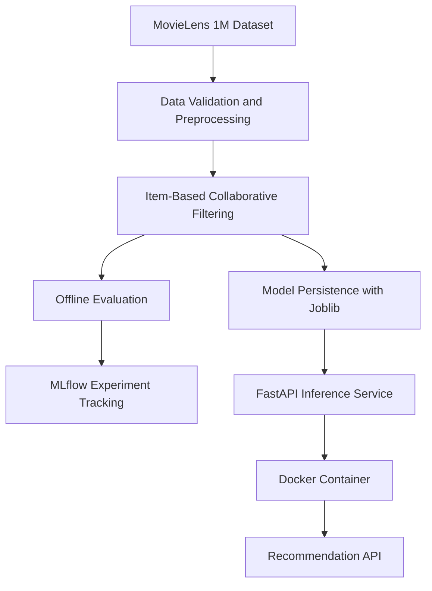

<h1 align="center">Recommendation Engine</h1>

<p align="center">
  <a href="https://github.com/Moazzam-Matin/recommendation-engine/actions/workflows/ci.yml">
    
  </a>
  
  
</p>

A movie recommendation engine built with Python, demonstrating practical machine learning engineering and MLOps workflows.

The project implements item-based collaborative filtering using the MovieLens 1M dataset, with offline evaluation, MLflow experiment tracking, model persistence, a FastAPI inference service, Docker containerization, automated testing, and cross-platform CI.

**The goal:** demonstrate the engineering lifecycle of a machine learning application — from data preparation and model evaluation to experiment tracking, API serving, and containerization.

## Project Overview

This project uses the [MovieLens 1M dataset](https://grouplens.org/datasets/movielens/1m/) to build and evaluate a movie recommendation model.

The current implementation uses **item-based collaborative filtering**. It identifies movies with similar rating patterns and recommends movies a user has not rated yet.

Rather than focusing exclusively on recommendation quality, the project demonstrates the engineering practices involved in building and deploying a machine learning application.

## Key Features

- Item-based collaborative filtering
- Data validation and duplicate-rating aggregation
- Top-N recommendations for known users
- Offline model evaluation
- Precision@K, Recall@K, and NDCG@K
- Catalog coverage and recommendation-completion diagnostics
- MLflow experiment tracking
- Model serialization and loading using Joblib
- FastAPI inference API
- API and model testing with pytest
- Docker image creation and containerized deployment
- Docker Compose application management
- GitHub Actions CI across multiple operating systems and Python versions

## Architecture

The project follows a simple machine learning workflow, separating model development, evaluation, persistence, and inference.



**Workflow:**

1. Load and validate movie-rating data.
2. Train the item-based collaborative filtering model.
3. Evaluate recommendations using offline metrics.
4. Record experiment parameters and metrics with MLflow.
5. Serialize the trained model using Joblib.
6. Load the persisted model through the FastAPI application.
7. Serve recommendations through a Dockerized API.

## Tech Stack

| Technology | Purpose |
|---|---|
| Python | Core implementation |
| Pandas and NumPy | Data processing |
| scikit-learn | Supporting machine learning utilities |
| SciPy | Sparse matrix operations |
| Joblib | Model serialization and loading |
| MLflow | Experiment tracking |
| FastAPI | Model serving and API endpoints |
| Uvicorn | ASGI server |
| Docker | Application containerization |
| Docker Compose | Container lifecycle management |
| pytest | Automated testing |
| GitHub Actions | Continuous integration |

## Dataset

The project uses the [MovieLens 1M dataset](https://grouplens.org/datasets/movielens/1m/).

Dataset characteristics:

| Property | Value |
|---|---:|
| Ratings | 1,000,209 |
| Users | 6,040 |
| Movies | 3,706 |

The evaluation workflow separates the ratings into training and test sets to measure recommendation performance against held-out user preferences.

| Split | Ratings |
|---|---:|
| Training | 802,553 |
| Testing | 197,656 |
| Total | 1,000,209 |

## Project Structure

```text
recommendation-engine/
├── artifacts/
│   └── cf_model.joblib
├── data/
├── notebooks/
├── scripts/
│   └── run_baseline.py
├── src/
│   └── recommendation_engine/
│       ├── api/
│       │   └── main.py
│       ├── evaluation.py
│       └── models/
│           └── collaborative.py
├── tests/
│   ├── conftest.py
│   ├── test_api.py
│   ├── test_collaborative.py
│   ├── test_evaluation.py
│   └── test_tracking.py
├── .github/
│   └── workflows/
│       └── ci.yml
├── .dockerignore
├── .gitignore
├── compose.yaml
├── Dockerfile
├── pyproject.toml
├── requirements-docker.txt
└── README.md
```

The structure above highlights the main application components. Additional configuration and supporting files may also be present.

**Note:** The trained model artifact is generated locally and is excluded from Git. It is not included when cloning the repository.

## Getting Started

### Prerequisites

- Python 3.13 or 3.14
- Git
- MovieLens 1M dataset

### 1. Clone the repository

```bash
git clone https://github.com/Moazzam-Matin/recommendation-engine.git
cd recommendation-engine
```

### 2. Create and activate a virtual environment

**Windows PowerShell:**

```powershell
python -m venv venv
.\venv\Scripts\Activate.ps1
```

**macOS or Linux:**

```bash
python -m venv venv
source venv/bin/activate
```

### 3. Install dependencies

```bash
python -m pip install --upgrade pip
pip install -e ".[dev]"
```

Ensure the MovieLens dataset is available in the location expected by the training script.

### 4. Run the tests

```bash
python -m pytest -v
```

The test suite covers model behavior, evaluation metrics, validation, model persistence, MLflow tracking, and API functionality.

## Running the Baseline

Run the baseline evaluation and MLflow tracking script from the project root:

```bash
python scripts/run_baseline.py
```

The script evaluates the configured recommendation model and records experiment information in MLflow.

The trained model is serialized to:

```text
artifacts/cf_model.joblib
```

This artifact is required by the inference API and Docker image.

## Experiment Tracking with MLflow

The project integrates MLflow to track machine learning experiments.

Experiment runs record relevant parameters and evaluation metrics, making it possible to inspect and compare model configurations.

Start the MLflow UI:

```bash
mlflow ui
```

Open the address displayed in the terminal, typically:

```text
http://127.0.0.1:5000
```

The UI allows you to:

- Inspect experiment runs.
- Compare model parameters.
- Review evaluation metrics.
- Analyze results across different configurations.

The tracking location depends on the project's MLflow configuration.

## Model Evaluation

The evaluation workflow measures recommendation quality at different values of K.

| Metric | Description |
|---|---|
| Precision@K | Proportion of recommended items that are relevant |
| Recall@K | Proportion of relevant held-out items that are recommended |
| NDCG@K | Recommendation quality while accounting for ranking position |
| Catalog Coverage | Proportion of the item catalog recommended across users |

Additional diagnostics examine recommendation-list completion and the extent of the catalog reachable by the model.

### Current Baseline Results

The current baseline uses the following configuration:

| Parameter | Value |
|---|---:|
| `n_neighbours` | 5 |
| `min_co_ratings` | 2 |

Recorded evaluation results:

| Metric | K = 5 | K = 10 | K = 20 |
|---|---:|---:|---:|
| Precision@K | 0.0616 | 0.0587 | 0.0624 |
| Recall@K | 0.0253 | 0.0500 | 0.1061 |
| NDCG@K | 0.0675 | 0.0707 | 0.0899 |
| Catalog Coverage | 49.43% | 62.01% | 71.40% |

These results provide a reference point for the current evaluation setup. They are not a claim that the model is production-ready or universally optimal.

## Running the Inference API

The project includes a FastAPI application that loads the persisted model during application startup.

First, ensure the trained model exists at:

```text
artifacts/cf_model.joblib
```

Start the API locally:

```bash
uvicorn recommendation_engine.api.main:app --host 0.0.0.0 --port 8000
```

The API will be available at:

```text
http://localhost:8000
```

### API Endpoints

| Endpoint | Method | Description |
|---|---|---|
| `/health` | GET | Check API and model readiness |
| `/recommend/{user_id}` | GET | Generate movie recommendations |
| `/docs` | GET | Interactive Swagger API documentation |

### Example Requests

Get five recommendations for user 50:

```text
http://localhost:8000/recommend/50?n=5
```

Check API health:

```text
http://localhost:8000/health
```

Open interactive API documentation:

```text
http://localhost:8000/docs
```

The API also handles invalid requests and unknown users through appropriate HTTP error responses.

## Running with Docker

Docker packages the application and its runtime dependencies into a container image.

The Docker image includes the serialized model artifact, so the artifact must exist before building the image.

### Prerequisites

- Docker Desktop or Docker Engine
- A locally generated `artifacts/cf_model.joblib`

### 1. Build the Docker image

From the project root:

```powershell
docker build -t recommendation-engine:0.1.2 .
```

### 2. Run the container

```powershell
docker run -d --name re-api -p 8000:8000 recommendation-engine:0.1.2
```

### 3. Verify the API

Health check:

```powershell
Invoke-RestMethod http://localhost:8000/health
```

Get recommendations:

```powershell
Invoke-RestMethod "http://localhost:8000/recommend/50?n=5"
```

Swagger documentation:

```text
http://localhost:8000/docs
```

### 4. View container logs

```powershell
docker logs re-api
```

### 5. Stop and remove the container

```powershell
docker stop re-api
docker rm re-api
```

## Running with Docker Compose

Docker Compose provides a convenient way to build, start, and manage the application.

Ensure the model artifact exists before starting the application.

Build the image and start the application:

```powershell
docker compose up -d --build
```

Check running services:

```powershell
docker compose ps
```

View application logs:

```powershell
docker compose logs api
```

Stop the application without removing its containers:

```powershell
docker compose stop
```

Start existing stopped containers:

```powershell
docker compose start
```

Stop and remove containers and the default network:

```powershell
docker compose down
```

The Docker image and local project files remain available after running `docker compose down`.

## Testing and Continuous Integration

The project uses pytest for automated testing and GitHub Actions for continuous integration.

The test suite covers:

- Collaborative filtering model behavior.
- Evaluation metrics and recommendation diagnostics.
- Data validation.
- Model persistence and loading.
- MLflow experiment tracking.
- FastAPI endpoints and error handling.

Run the full test suite locally:

```bash
python -m pytest -v
```

### GitHub Actions CI

The CI workflow automatically runs on pushes and pull requests targeting the `main` branch.

The test matrix covers:

| Operating System | Python Versions |
|---|---|
| Ubuntu | 3.13, 3.14 |
| Windows | 3.13, 3.14 |
| macOS | 3.13, 3.14 |

**Total: 6 CI configurations.**

The workflow checks dependency installation and runs the automated test suite across all supported CI environments.

## Current Limitations

- The current recommender uses item-based collaborative filtering only.
- Recommendations depend on the rating data available to the model.
- Evaluation results depend on the dataset, train/test split, and relevance definition.
- The current API loads a serialized model during application startup.
- Production monitoring, authentication, and cloud deployment infrastructure are not implemented.
- The model artifact must be generated separately and is not committed to the repository.

## Future Improvements

Potential areas for further development include:

- API performance and operational monitoring.
- Cloud deployment.
- Model versioning and deployment management.
- Improved observability and production-readiness.
- Additional recommendation approaches and model comparisons.

## Author

**Moazzam Matin**

- GitHub: [Moazzam-Matin](https://github.com/Moazzam-Matin)
- Repository: [Recommendation Engine](https://github.com/Moazzam-Matin/recommendation-engine)

---

*Built as a practical demonstration of machine learning engineering and MLOps workflows.*